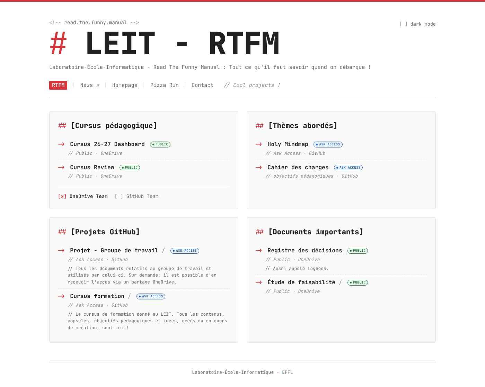
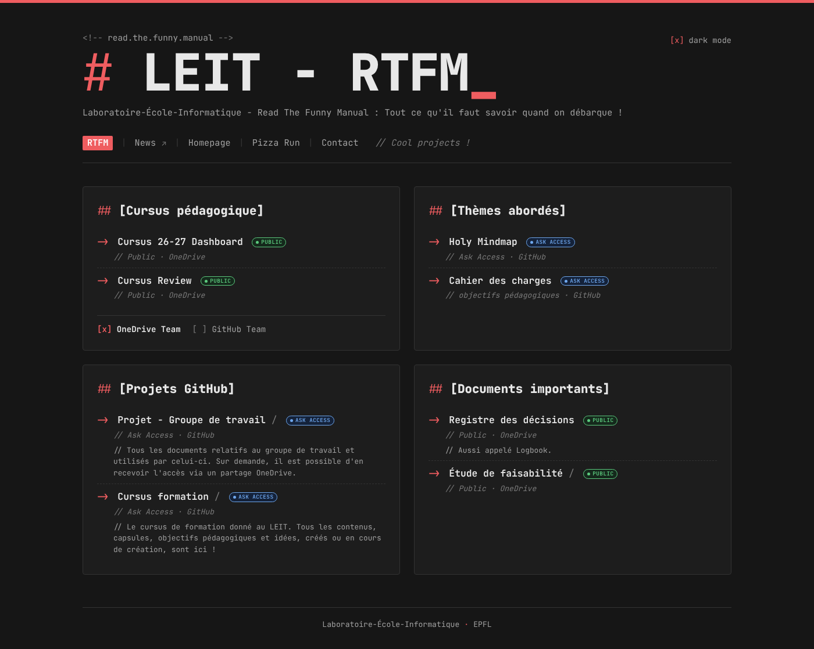

# LEIT - RTFM · Read The Funny Manual

> Laboratoire-École-Informatique - Read The Funny Manual : tout ce qu'il faut savoir quand on débarque !



## Le but du projet

Quand on arrive au **Laboratoire-École-Informatique (LEIT)**, l'information est partout : OneDrive, GitHub, PDF, mindmaps, cahiers des charges…
**RTFM** regroupe tous ces documents sur **une seule page**, pour qu'un nouveau formateur ou une nouvelle formatrice trouve en quelques secondes ce qu'il lui faut.

La page est organisée en quatre blocs :

| Section | Contenu |
| --- | --- |
| **[Cursus pédagogique]** | Cursus 26-27 Dashboard, Cursus Review. Choix de la source : `[x] OneDrive Team` ou `[ ] GitHub Team` |
| **[Thèmes abordés]** | Holy Mindmap, Cahier des charges (objectifs pédagogiques) |
| **[Projets GitHub]** | Projet - Groupe de travail, Cursus formation |
| **[Documents importants]** | Registre des décisions (Logbook), Étude de faisabilité |

Chaque lien porte une pastille d'accès :

- 🟢 **public** : on clique et c'est ouvert.
- 🔵 **ask access** : il faut demander l'accès. Un clic sur la pastille ouvre la popup **Contact** du formateur responsable.

## Le style

Sobre, geek et lisible : police **JetBrains Mono**, rendu façon markdown (`#`, `##`, `->`, `// commentaires`) et couleurs **EPFL** (rouge et gris).
Thème clair par défaut, thème sombre avec la case `[ ] dark mode`.



## Structure

```
index.html   la page (contenu + petits scripts : thème, source OneDrive/GitHub, popups, machine à écrire)
style.css    tout le style
docs/        captures d'écran du README
```

Pas de framework, pas de build : HTML + CSS + quelques lignes de JavaScript.

## Modifier un lien

Tout se passe dans `index.html` :

- Un lien classique : remplacer le `href` du `<a>`.
- Les liens du Cursus : modifier `data-onedrive` et `data-github`. Le `href` suit automatiquement le choix de la source.
- Une pastille : `<span class="pill public">` (vert), `<span class="pill ask">` (bleu) ou `<span class="pill warn">` (warning).

## Déployer sur Cloudflare Pages

- Framework preset : **None**
- Build command : *(vide)*
- Build output directory : `/`

Chaque push sur `main` redéploie le site.

## Contact

Formateur responsable du LEIT : [Mathieu.Burnat@epfl.ch](mailto:Mathieu.Burnat@epfl.ch)
